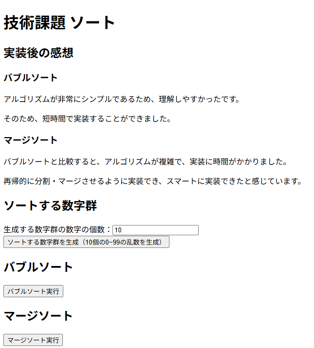

# 技術課題（ソート）

## 課題

Wikipediaの「ソート」に記載されたソートから2個実装してください。<br>
それらを実装したうえで、それぞれそのソートの良かった点を述べてください。<br>
使用する言語や入出力の形式は自由です。<br>
[Wikipedia](https://ja.wikipedia.org/wiki/%E3%82%BD%E3%83%BC%E3%83%88 "Wikipedia「ソート」")

## ソートの実装

app/lib/sortsの各ファイルにて、ソートの実装を行っています。
ご確認をよろしくお願いいたします。
今回は、バブルソートとマージソートを実装しました。

## 動作確認

### リポジトリのクローン

このリポジトリをクローンしてください。

### npmインストール

以下のコマンドを実行してください。

```bash
npm install
```

### 開発サーバー起動

以下のコマンドを実行してください。

```bash
npm run dev
```

### アプリケーションにアクセス

`http://localhost:5173`にアクセスしてください。<br>
アクセスすると、以下の画像のように表示されます。


### ソートする数字群を生成

`ソートする数字群を生成（n個の0~99の乱数を生成）`ボタンを押下してください。<br>
nには、ボタン上部の入力フォームで入力した数字が入ります。<br>
ボタン押下後、数字群がボタン下部に表示されます。<br>
ボタン押下前にソートを実行していた場合、ソート結果が削除されます。

### ソートを実行

`バブルソート実行`ボタンもしくは、`マージソート実行`ボタンを押下してください。<br>
ボタン押下後、ソート結果がボタン下部に表示されます。
